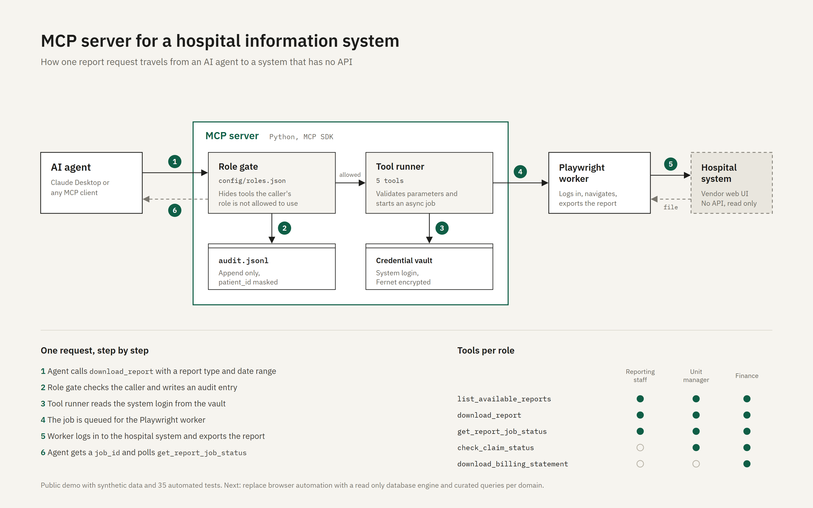

# mcp-secure-reports

An MCP server that lets an AI agent export reports from a system that has no API, without handing the agent more access than the person using it.

I built the first version for a hospital whose information system only has a web interface. This repository is a cleaned up public version: same design, synthetic data, no hospital names or real credentials.



## What it does

The agent (Claude Desktop, Claude Code or any MCP client) can list reports, start an export, poll until the file is ready, and look up insurance claims. Behind the server, a backend logs in to the legacy system and downloads the file.

Three things make it safe to point at sensitive data:

**Tools depend on the role.** One server process serves one role. Tools that role may not use are never registered, so the model does not see them in `tools/list` at all. Report types are filtered the same way. Permissions live in [`config/roles.json`](config/roles.json), so a change is a reviewed pull request, not a code change.

**Every call is audited.** Each tool call, allowed or denied, goes to an append only JSONL log with the role, user, parameters and duration. Fields such as `patient_id` are masked before they are written, including inside nested objects.

**Credentials never reach the model.** The login for the legacy system is stored in a Fernet encrypted vault. Only the backend reads it. No tool returns it, and each read is itself an audit event.

## Roles in the sample config

| Tool | reporting_staff | unit_manager | finance |
|---|:-:|:-:|:-:|
| `list_available_reports` | ✓ | ✓ | ✓ |
| `download_report` | ✓ | ✓ | ✓ |
| `get_report_job_status` | ✓ | ✓ | ✓ |
| `check_claim_status` | | ✓ | ✓ |
| `download_billing_statement` | | | ✓ |

## Try it

Requires Python 3.10 or newer.

```bash
python -m venv .venv
.venv/bin/pip install -e ".[dev]"        # Windows: .venv\Scripts\pip
.venv/bin/python scripts/demo.py
```

The demo starts the server twice over stdio, once as `reporting_staff` and once as `finance`, and prints what each role sees:

```
=== Connected as reporting_staff ===
  tools/list: download_report, get_report_job_status, list_available_reports
  > download_report({"report_type": "monthly_visits", ...})
    ok: {"job_id": "f1cf76f6...", "status": "queued", "next": "poll get_report_job_status"}
  > download_report({"report_type": "insurance_claims", ...})
    error: Error executing tool download_report: Report type 'insurance_claims' is not allowed for this role

=== Connected as finance ===
  tools/list: check_claim_status, download_billing_statement, download_report, get_report_job_status, list_available_reports

=== audit.jsonl ===
  reporting_staff  download_report     failed   {"report_type": "insurance_claims", ...}
  finance          check_claim_status  success  {"claim_id": null, "patient_id": "00******78"}
```

Run the tests:

```bash
.venv/bin/python -m pytest
```

## Use it from Claude Desktop

Generate a vault key once:

```bash
python -c "from cryptography.fernet import Fernet; print(Fernet.generate_key().decode())"
```

Then add the server to `claude_desktop_config.json`:

```json
{
  "mcpServers": {
    "secure-reports": {
      "command": "/path/to/mcp-secure-reports/.venv/bin/secure-reports-mcp",
      "env": {
        "MCP_ROLE": "reporting_staff",
        "VAULT_MASTER_KEY": "paste the key here",
        "DATA_DIR": "/path/to/mcp-secure-reports/data"
      }
    }
  }
}
```

Ask Claude for "the monthly visits report for September 2026" and it will start the export, poll the job and tell you where the file is. Open `data/audit.jsonl` to see what was logged.

## Configuration

| Variable | Default | Purpose |
|---|---|---|
| `MCP_ROLE` | `reporting_staff` | Role served by this process |
| `MCP_USER` | `demo_user` | User id written to the audit log |
| `VAULT_MASTER_KEY` | none, required | Fernet key for the credential vault |
| `BACKEND` | `mock` | `mock` for synthetic data, `playwright` for a real system |
| `MOCK_DELAY_SECONDS` | `2` | How long a mock export takes |
| `DATA_DIR` | `./data` | Audit log, vault file and exports |
| `CONFIG_PATH` | `config/roles.json` | Role and tool definitions |

## Project layout

```
src/secure_reports_mcp/
  server.py    registers tools for the active role, audits every call
  tools.py     tool logic, no MCP or logging concerns
  backend.py   MockBackend (synthetic data) and the PlaywrightBackend interface
  vault.py     Fernet encrypted credential store
  audit.py     append only JSONL log with field masking
  config.py    loads and validates config/roles.json
scripts/demo.py   end to end run over the MCP protocol
tests/            35 tests: masking, vault, config, role filtering, job lifecycle
```

## What is mocked

`MockBackend` runs the full flow, including the vault read and the async job, but writes a small CSV of made up numbers instead of logging in anywhere. `PlaywrightBackend` defines where real browser automation goes and raises `NotImplementedError`, because selectors depend on the target system. In the hospital deployment the next step is a read only database backend with a fixed set of queries per domain, rather than free form SQL.

Role selection by environment variable is fine for a single user on a desktop. A shared deployment should take the role from an authenticated session instead.

## License

MIT
